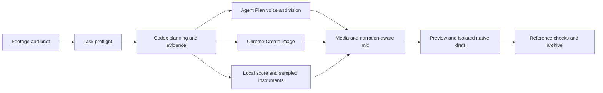

# Jianying Draft Collaboration

[简体中文](README.md) · [Setup](docs/INSTALL.en.md) · [Windows VM checklist](docs/windows-vm-test.md) · [Native compatibility](skills/jianying-draft-collab/references/compatibility.md)


A Codex skill for turning real footage into **editable Jianying Pro drafts, import folders and complete previews on Windows**. It also revises saved drafts, replaces BGM while preserving user edits, and archives the final exported result.

Music is authored as editable notes, rendered with sampled instruments, and delivered as MIDI, stems and a narration-aware mix. Production starts after task-specific checks; native compatibility is verified on the recipient's installed editor.

## See the result


[Play the public sample](docs/media/demo.mp4) · [Hear the original instrumental](docs/media/music.mp3)

This purpose-made synthetic fixture demonstrates local media and music processing. It is not a filmed experiment or an editor screenshot. See [asset sources](docs/media/README.md).

## Start from scratch

You need **Windows 11 x64, Codex and your own installed Jianying Pro**. Initial setup downloads managed dependencies. Preinstalled Python, Conda, Git, FFmpeg and a D: drive are not required.

1. Download and extract this repository, or clone it. Open PowerShell in its root.
2. Install:

```powershell
powershell -NoProfile -File .\install.ps1
```

The installer deploys the skill and prepares separate video and music environments plus selected sound banks under `%LOCALAPPDATA%\JianyingDraftCollab`. Set `-RuntimeRoot` or `-SkillRoot` to choose other locations. Existing configuration is preserved and modified managed files are reported as conflicts.

3. Check the local setup and render a sample without API keys:

```powershell
$runtime = Join-Path $env:LOCALAPPDATA 'JianyingDraftCollab'
& "$runtime\run.ps1" env doctor --task install --details
& "$runtime\run.ps1" env smoke --local-only --output "$runtime\checks\first-smoke"
```

4. Ask Codex:

```text
Use $jianying-draft-collab on my footage folder.
Check the required environment and native editor capabilities before production.
Deliver an editable draft and preview. Write restrained melodic instrumental BGM,
keep it quiet under narration, and let it rise gently in longer observation gaps.
```

[Setup and recovery](docs/INSTALL.en.md) covers caches, offline operation and diagnostics. Follow your organization's process if script execution is restricted.

## Requirements by capability

| Capability | Requirement |
|---|---|
| Media, instrumental BGM, mixing and key-free sample | Managed Python, FFmpeg, FluidSynth and selected sound banks; local CPU rendering |
| New narration, speech recognition and visual analysis | Recipient's own Agent Plan credentials and service access |
| New explanatory image pages | Connected host Chrome, signed-in ChatGPT, Create image and original download access |
| Native draft creation and editing | Isolated read/write/reopen validation on the installed Jianying version |
| Final closeout | Actual export, latest saved draft and complete media references |

Configure the runtime's `.env`; process variables take precedence. Setup ships an empty-key template. Configuration, successful cloud calls, browser access and real image generation are separate checks. Ordinary doctor makes no cloud requests.

## Coordinated background music

Choose an original score, an audio file, or no BGM. Codex writes a theme, form and performance to suit the picture; a pinned renderer produces the master, MIDI and stems. Mixing protects both caption spans and actual audio activity, holds the bed down across short pauses and restores it gently in longer observation gaps.

The teaching preset targets about 26 dB of narration-to-music separation in active windows, with a P10 acceptance threshold of 24 dB and a mix true peak at or below −1 dBTP. Settings are configurable. Measurements and listener feedback are recorded separately. A BGM-only revision preserves narration bytes and the user's timeline.

[Music workflow and outputs](skills/jianying-draft-collab/references/bgm.md)

## Keep your working editor version

The skill reuses an installed, verified editor and does not upgrade or downgrade it. A known protocol takes the fast path. If the interface changes, Codex inspects local evidence and converges on an adapter in an isolated draft before enabling the operations this task needs.

Local evidence is bound to executable and adapter fingerprints. Changes invalidate it. Version numbers and DLL presence alone do not prove write compatibility. Drafts, proprietary binaries and adaptation records stay on the recipient's device.

## Data flow



Originals, previous versions and user edits are preserved. The workflow does not take over the editor UI; registering a new project waits for the editor to exit naturally. New explanatory image pages use Chrome Create image. Evidence frames, subtitle tracks and numerical test fixtures keep their distinct roles.

## Validation and contributions

The first release includes automated checks, a Windows installation workflow and a [VM checklist](docs/windows-vm-test.md). Local, CI, relocated-directory and recipient-VM evidence are recorded separately in [validation status](docs/VALIDATION.md).

Report versions, task type, failed stage and sanitized diagnostics. Keep local adapter evidence, but do not upload private drafts, secrets or editor binaries. See [CONTRIBUTING.md](CONTRIBUTING.md).

Original code is [MIT](LICENSE); dependencies retain their terms in [THIRD_PARTY_NOTICES.md](THIRD_PARTY_NOTICES.md). Jianying Pro is separately installed and licensed. This project is not affiliated with its publisher.
