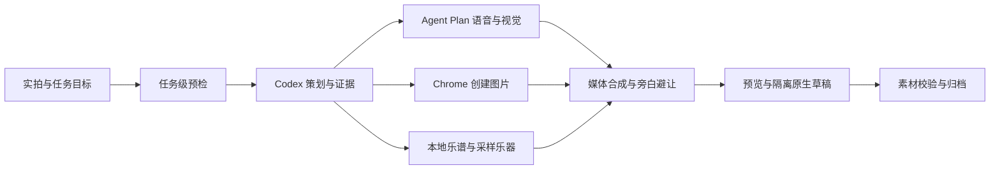

# 剪映草稿协作

[English](README.en.md) · [安装与配置](docs/INSTALL.md) · [虚拟机验收](docs/windows-vm-test.md) · [版本适配](skills/jianying-draft-collab/references/compatibility.md)
[发行版 v0.1.0](https://github.com/HNNUYUXUAN/jianying-draft-collab/releases/tag/v0.1.0) · [Windows CI](https://github.com/HNNUYUXUAN/jianying-draft-collab/actions/runs/43722607443)


让 Codex 在 Windows 上将实拍素材制作成**可编辑剪映草稿、导入包和完整预览**，也可在保留用户最后保存内容的基础上专项更换配乐、修订图页和归档最终成片。

配乐由可修改的音符乐谱渲染，包含旋律、和声、乐器分轨及旁白避让。正式制作前先检查任务所需环境；剪映版本在接收端验证，继续使用已经可用的安装。

## 看看结果


[播放完整公开样例](docs/media/demo.mp4) · [听原创器乐样例](docs/media/music.mp3)

样例是专门制作的合成验证工程，展示本地媒体与 BGM 流程；不是实拍实验或软件界面。来源和生成方式见[素材说明](docs/media/README.md)。

## 从零开始

准备 **Windows 11 x64、Codex，以及你自行安装的剪映专业版**。首次安装需要联网下载受管依赖；无需预装 Python、Conda、Git、FFmpeg，也不要求 D 盘。

1. 下载本仓库源码并解压，或使用 Git 克隆；在仓库目录打开 PowerShell。
2. 执行安装：

```powershell
powershell -NoProfile -File .\install.ps1
```

安装器部署技能，并在 `%LOCALAPPDATA%\JianyingDraftCollab` 准备视频、音乐两个独立环境及选定采样音源。可用 `-RuntimeRoot` 指定运行目录，`-SkillRoot` 指定技能目录。已有配置和用户修改会被保留或明确报告冲突。

3. 运行本地检查和无密钥样例：

```powershell
$runtime = Join-Path $env:LOCALAPPDATA 'JianyingDraftCollab'
& "$runtime\run.ps1" env doctor --task install --details
& "$runtime\run.ps1" env smoke --local-only --output "$runtime\checks\first-smoke"
```

4. 在 Codex 中使用：

```text
使用 $jianying-draft-collab 读取我的素材目录。
先检查这次制作所需环境和剪映能力，再制作可编辑草稿与预览。
配乐要有清楚但克制的旋律和和声，旁白期间轻铺，观察空隙平缓抬升。
```

安装、恢复、离线缓存与常见诊断见[安装说明](docs/INSTALL.md)。组织策略阻止脚本执行时，按所在环境的许可流程处理。

## 各能力需要什么

| 能力 | 条件 |
|---|---|
| 媒体处理、原创 BGM、混音及无密钥样例 | 受管 Python、FFmpeg、FluidSynth 和选定音源；本地 CPU 渲染 |
| 新旁白、语音识别、视觉分析 | 接收者自己的 Agent Plan 凭据及可用服务 |
| 新增讲解整图 | Codex 已连接的 Chrome、ChatGPT 登录及“创建图片”／下载能力 |
| 原生草稿创建与编辑 | 本机剪映后台能力经过隔离读写及重读验证 |
| 最终归档 | 最终成片、最后保存的草稿及完整素材引用 |

将凭据填写到运行目录的 `.env`；进程环境优先。安装器只放置空模板。云配置存在、云调用成功、Chrome 可读和真实生图分别验证，普通 doctor 不产生云请求。

## 协调 BGM

支持原创乐谱、用户音频和无 BGM。Codex 按内容安排主题、段落与演奏，固定渲染器输出母带、MIDI 和分轨；混音器结合字幕区间与实际音频活动保护旁白，合并短停顿，在长观察区间平滑恢复。

教学旁白预设以活动窗口约 26 dB 的旁白／配乐差距为目标，P10 验收至少 24 dB，混音真峰值不超过 −1 dBTP。参数可覆盖，技术测量与实际听感分开记录。专项改配乐保留原旁白字节及用户时间线。

[BGM 工作流与输出](skills/jianying-draft-collab/references/bgm.md)

## 使用现有剪映版本

技能优先复用本机已经验证可用的安装，不自动升级或降级。已知后台协议走快速路径；遇到变化时，Codex 读取本地接口证据，在隔离草稿上收敛适配，通过本任务需要的读写检查后缓存到该设备。

本机记录绑定实际工具与适配器指纹，变化后重新验证。支持能力由真实测试决定；版本号或 DLL 存在本身不代表写入已经可用。适配诊断、用户草稿和应用二进制留在接收端。

## 流程与边界



原始输入、旧版本和用户编辑保留。剪映运行时不抢占界面；注册新草稿等待应用自然退出。全部新增讲解图页走 Chrome“创建图片”；真实抽帧、字幕和程序数值测试各自保持清楚身份。

## 验证与参与

首版随附自动化测试、Windows 安装流程和[虚拟机测试清单](docs/windows-vm-test.md)。本机、CI、独立目录和接收端虚拟机证据分别记录，见[验证状态](docs/VALIDATION.md)。

报告问题时提供工具版本、任务类型、失败阶段及脱敏诊断；保留本地适配回执，避免上传原草稿、密钥或应用文件。贡献步骤见 [CONTRIBUTING.md](CONTRIBUTING.md)。

自有代码采用 [MIT](LICENSE)，第三方声明见 [THIRD_PARTY_NOTICES.md](THIRD_PARTY_NOTICES.md)。剪映专业版由接收者自行安装授权，本项目与剪映官方无隶属关系。
